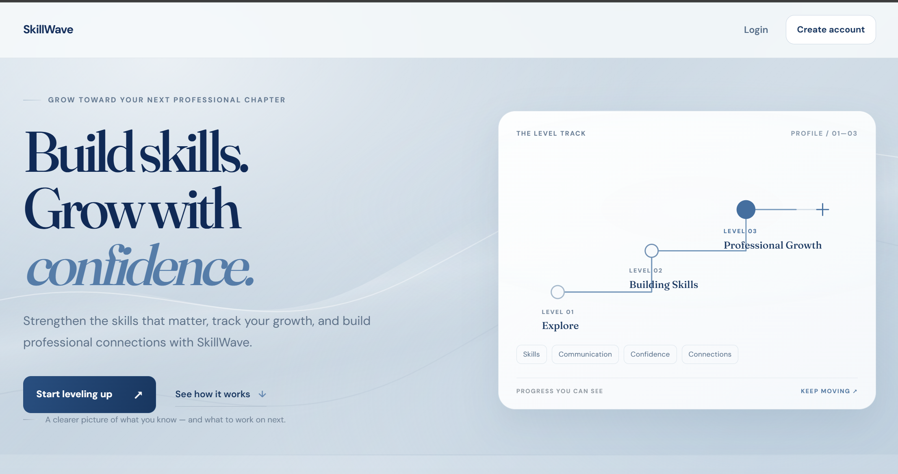
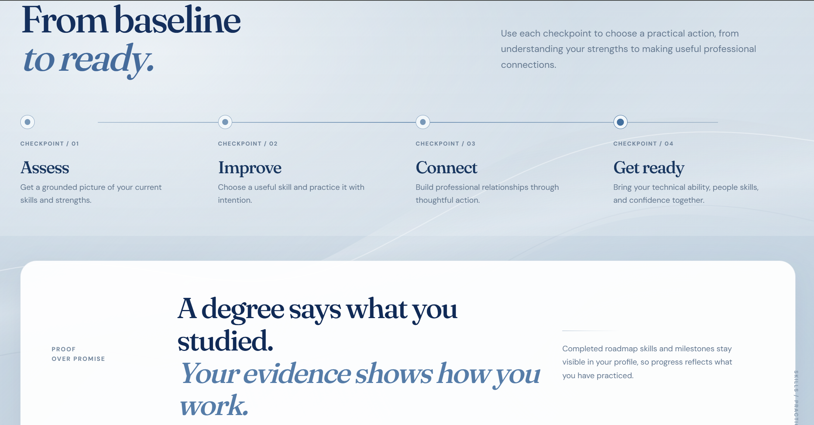
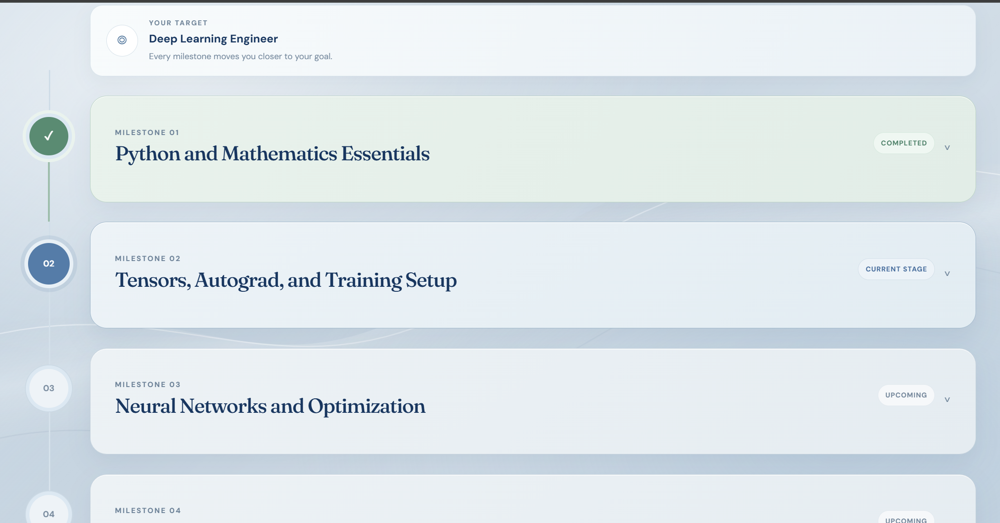

# SkillWave — A Professional Development Ecosystem

SkillWave is a web application for people who want a structured way to build professional skills, practice workplace scenarios, track growth, and nurture career relationships.

## Project overview

Professional development can be difficult to organize across separate learning tools and informal goals. SkillWave brings career roadmaps, soft skills practice, networking activities, and progress tracking into one browser based experience. It is intended for learners and professionals who want to plan and monitor their development.

## Screenshots

The screenshots below are captures of the application included in this repository.

| Dashboard |
| --- |
|  |

| How it works | Career roadmap |
| --- | --- |
|  |  |

| Roadmap flow | Soft Skills |
| --- | --- |
|  |  |

| Networking |
| --- |
|  |

## Features

- **Dashboard and Growth Snapshot:** overview of progress across Technical Skills, Soft Skills, and Networking.
- **Career roadmaps:** role based stages, missions, and skills, with expandable milestones and completion tracking.
- **Soft Skills practice:** scenario based practice and a prompt users can copy into an AI assistant they choose. The application does not call an AI service.
- **Networking:** guided networking activities and a Relationship Tracker for saving contacts, including contact information.
- **Progress tracking:** completion state is stored for the authenticated user in Supabase.
- **Authentication:** Supabase Auth supports account registration, sign in, password recovery, and password reset.
- **Account deletion:** account settings can call the <code>delete-account</code> Supabase Edge Function to request account deletion.

## Technology

- HTML pages with CSS stylesheets
- Browser JavaScript using ES modules and the Supabase JavaScript client
- Supabase Auth and PostgreSQL with Row Level Security
- Supabase Edge Functions, written in TypeScript and run on Deno
- Node.js for the repository's roadmap data validation script

The frontend is static; the repository does not define a frontend build step.

## Architecture

The browser loads the HTML, styles, and JavaScript. The account code creates a Supabase client using the public project URL and publishable key configured in <code>js/supabase-config.js</code>. Auth provides the current user session. Progress and contact data access uses that user identity; database policies are defined in the migrations.

Account deletion is requested from account settings by invoking the <code>delete-account</code> Edge Function. The function validates the caller's bearer token with Supabase Auth before deleting the corresponding user through the Admin API using a server side secret supplied by the Edge Function environment.

~~~mermaid
flowchart LR
  Browser[Static HTML CSS JavaScript] -->|public URL and publishable key| Supabase[Supabase]
  Browser <-->|authentication and session| Auth[Supabase Auth]
  Browser <-->|user scoped reads and writes| DB[(PostgreSQL with RLS)]
  Browser -->|authenticated invocation| Edge[delete-account Edge Function]
  Edge -->|verify token and delete user| Auth
~~~

## Project structure

- <code>*.html</code> — application pages, including the Dashboard, Roadmap, Soft Skills, and Networking experiences.
- <code>css/</code> — page and shared stylesheets.
- <code>js/</code> — page behavior, Supabase configuration, authentication, and progress-store code.
- <code>data/</code> — roadmap and application data used by the frontend.
- <code>screenshots/</code> — application screenshots referenced above.
- <code>scripts/validate-roadmaps.js</code> — roadmap data validator.
- <code>supabase/migrations/</code> — SQL schema and Row Level Security migrations.
- <code>supabase/functions/delete-account/</code> — account deletion Edge Function.
- <code>SUPABASE_ACCOUNT_DELETION.md</code> and <code>SUPABASE_AUTH_SETUP.md</code> — setup and operational guidance.

## Prerequisites and local setup

You need a modern browser, Node.js with npm for the roadmap validator, and a local static HTTP server. Configure a Supabase project as described below for authenticated and database backed features.

From the repository root, start Python's built in static server:

~~~powershell
py -m http.server 5500
~~~

If the <code>py</code> launcher is unavailable but Python is on PATH, use:

~~~sh
python -m http.server 5500
~~~

Then open <code>http://localhost:5500/</code>. The server serves the repository files; it does not build or bundle the frontend. Stop it with Ctrl+C.

## Supabase configuration

1. Create or select a Supabase project.
2. Set the project URL and publishable key in <code>js/supabase-config.js</code> as <code>window.SUPABASE_CONFIG</code>. This is browser configuration; never put a service role or secret key in frontend files or this README.
3. Apply the committed SQL migrations in <code>supabase/migrations/</code> to create the profiles, progress, practice, networking, and RLS schema. Review each migration and use the Supabase SQL Editor or your established migration workflow.
4. Add the local password recovery callback URL to the Supabase Auth URL configuration. The project setup documentation gives <code>http://localhost:5500/reset-password.html</code> as a local example. Configure the corresponding URL for your own hosting origin when deploying.
5. Set up the account deletion Edge Function using the instructions in <code>SUPABASE_ACCOUNT_DELETION.md</code>. Link the Supabase CLI to your own project, then deploy <code>delete-account</code> with JWT verification enabled. Configure the required server side secret in the Edge Function environment; never expose it to the browser.

### Pending contact information migration

<code>supabase/migrations/202610100001_networking_contact_information.sql</code> adds the nullable <code>contact_information</code> text column to <code>public.networking_contacts</code>. The migration file is present in the repository but has not been applied to the Supabase database. Apply it to your project before relying on the Relationship Tracker's new contact information field against that database. No live database change is performed by this repository README setup.

## Database and security

The migrations define these application tables:

- <code>profiles</code>
- <code>roadmap_skill_progress</code> and <code>roadmap_mission_progress</code>
- <code>soft_skill_progress</code> and <code>soft_skill_practice</code>
- <code>networking_journey_progress</code>, <code>networking_scenario_progress</code>, and <code>networking_contacts</code>

The migrations enable RLS and define user scoped policies for the relevant data tables. Frontend progress-store operations include the authenticated user's ID in data operations. The contact information migration only adds a nullable column; it does not alter RLS policies. Review the SQL migrations and configure keys and project access carefully for your own deployment.

## Validation

Run the repository's defined roadmap data validation command from the project root:

~~~sh
npm run validate:roadmaps
~~~

This validates roadmap data. The repository does not define a general automated browser test suite.

## Deployment considerations

The repository has no configured frontend hosting provider or deployment workflow. Host the static project files on a static web server and configure the Supabase URL allowlist, password recovery redirect URLs, and browser configuration for the intended origin. Apply the database migrations, including the pending contact information migration, to the target project through your chosen migration process. Deploy the Edge Function separately and configure its server side environment. Do not expose secret keys in static files.

## Limitations and future improvements

Implemented behavior and configuration details can be reviewed in the source and setup documentation. The Soft Skills practice feature prepares a prompt for the user to copy; it does not integrate with an AI provider. The contact information database column requires the pending migration above. The repository currently defines roadmap data validation but no automated browser test suite, frontend build pipeline, or hosting workflow.

## Contributing and license

No contribution guide or license is currently defined in the repository. Review the source and project documentation before proposing changes; contact the repository owner to discuss contributions and licensing.
