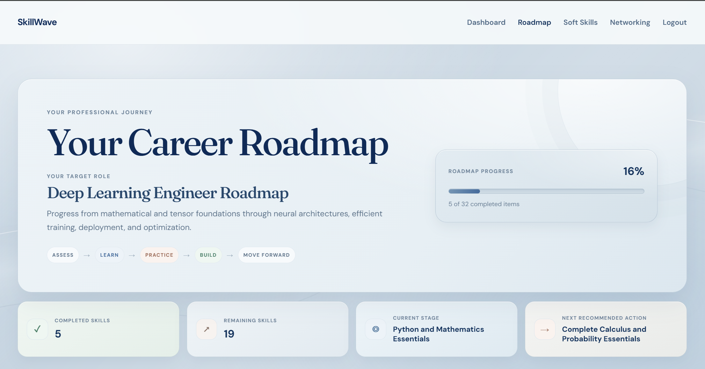
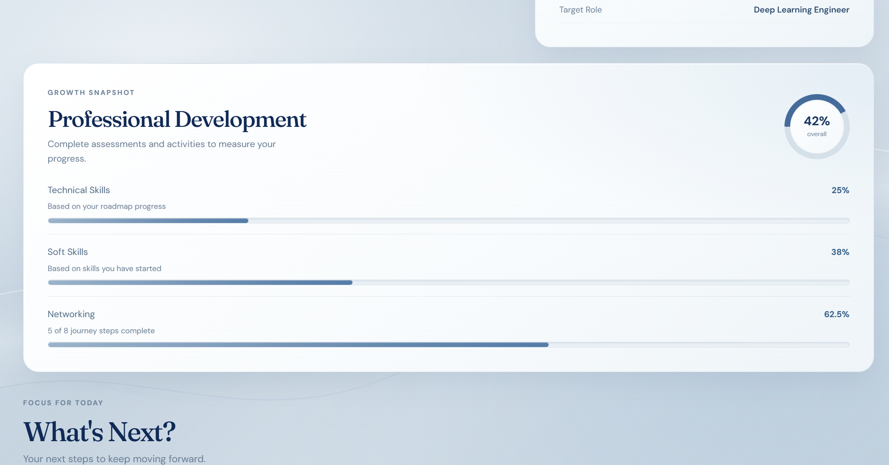
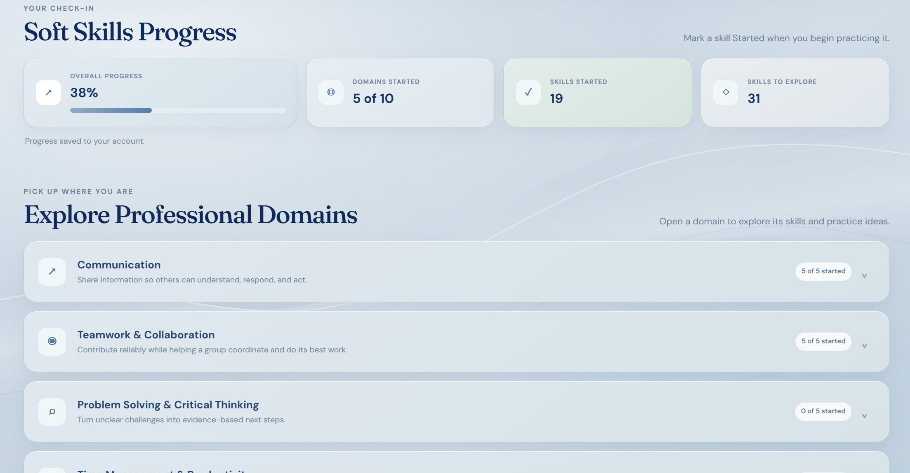
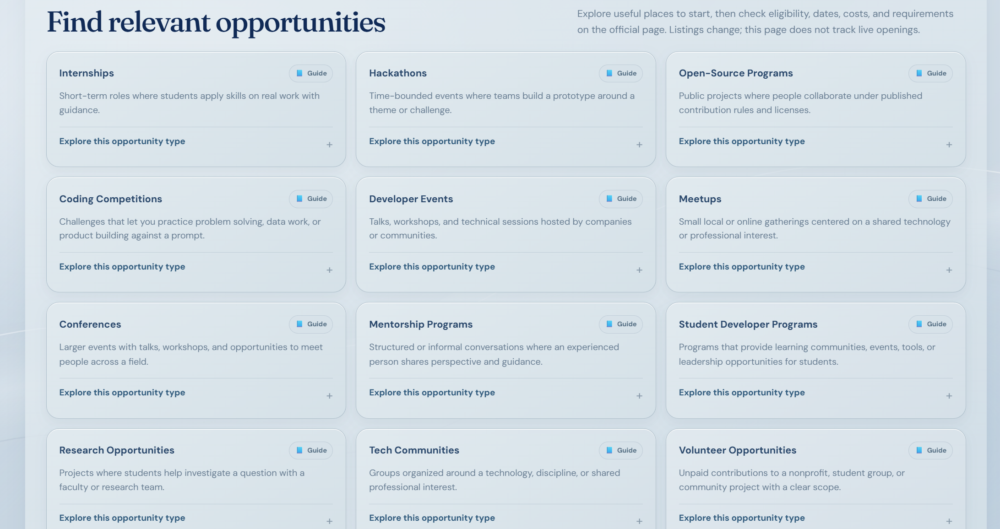

# SkillWave

### Build your career, one intentional step at a time.

SkillWave is a browser-based professional development workspace that brings career roadmaps, soft-skills practice, networking activities, and progress tracking into one place. Create a profile, choose a target role, and keep your development activities and milestones organized as you grow.

**Live Demo:** _Not deployed yet — the deployment URL will be added here._

## A look inside

| Career roadmap | Growth dashboard |
| --- | --- |
|  |  |

| Soft-skills practice | Networking tracker |
| --- | --- |
|  |  |

## What you can do

- **Follow career roadmaps** with role-based skills, missions, and completion tracking.
- **Practice soft skills** through workplace scenarios and reflection activities. Prompts can be copied to an AI assistant; SkillWave does not call an AI service.
- **Build professional connections** with guided networking activities and a contact tracker.
- **See your progress** across technical skills, soft skills, and networking on the dashboard.
- **Manage your account** with sign-up, sign-in, password recovery, and account deletion.

## Built with

- HTML, CSS, and browser JavaScript (ES modules)
- Supabase Auth and PostgreSQL with Row Level Security (RLS)
- Supabase Edge Functions with TypeScript and Deno for account deletion
- Node.js for roadmap data validation

The frontend is static and has no build step.

## Local development

To preview the source directly, run this from the repository root:

```sh
python -m http.server 5500
```

On Windows, `py -m http.server 5500` also works. Open [http://localhost:5500](http://localhost:5500). Configure Supabase first to use authentication and saved account data.

To preview the exact generated deployment folder, run `npm run prepare:deploy`, then serve `dist/` with `python -m http.server 5500 --directory dist` (or `py` on Windows).

## Deploy with Netlify

The repository's [`netlify.toml`](netlify.toml) runs `npm run prepare:deploy` and publishes `dist/`. The preparation script copies only the required HTML pages, stylesheets, and browser scripts; it excludes screenshots, docs, Supabase migrations and function source, and repository metadata.

1. Push this repository to GitHub and import it into Netlify as a new site. Keep the repository root as the base directory; Netlify reads the build command and publish directory from `netlify.toml`.
2. Confirm the deployed homepage and direct navigation to sign-up, sign-in, dashboard, roadmap, soft skills, networking, forgot-password, and reset-password pages.
3. Once Netlify provides the actual site URL, set Supabase Auth's Site URL to that site and add the full `<site-url>/reset-password.html` URL to Redirect URLs. Do not add a guessed URL.
4. Before enabling account deletion on the deployed site, update the Edge Function's CORS policy to allow the exact production origin and only required development origins. The current function allows every origin (`*`). Allowlist actual origins, return the matching origin for allowed requests, and apply the same check to `OPTIONS`; do not use a broad wildcard for production. The production URL is not known yet, and this repository change does not update or deploy the function.
5. Test authentication, password recovery, saved progress and contacts, and account settings with a dedicated test account. Verify the recovery email returns to the deployed reset-password page. Test account deletion only with a disposable account.

The frontend uses the public Supabase project URL and publishable browser key in `js/supabase-config.js`. Never add service-role keys, secret keys, access tokens, or database passwords to frontend files or Netlify build configuration. The Netlify configuration adds basic browser security headers.

## Supabase setup and security

Set the project URL and **publishable** browser key in `js/supabase-config.js`. Publishable keys are intended for client-side use; never place a secret or service-role key in frontend code. Supabase migrations define the application tables and RLS policies, so use an appropriately configured project for account-backed features. The deploy script uses an explicit allowlist and includes this browser configuration file, so it must contain only public client configuration.

Before applying migrations, confirm the linked Supabase project and compare local and remote migration history. The `contact_information` column exists in the remote database, but whether its migration is recorded as applied is still unverified. See [the setup guide](docs/SETUP.md) before taking migration-related action.

## Documentation

- [Supabase and migration setup](docs/SETUP.md)
- [Password recovery URL setup](SUPABASE_AUTH_SETUP.md)
- [Account deletion deployment](SUPABASE_ACCOUNT_DELETION.md)

Roadmap data can be checked with `npm run validate:roadmaps`. This command validates roadmap data; the repository does not define a general browser test suite.
